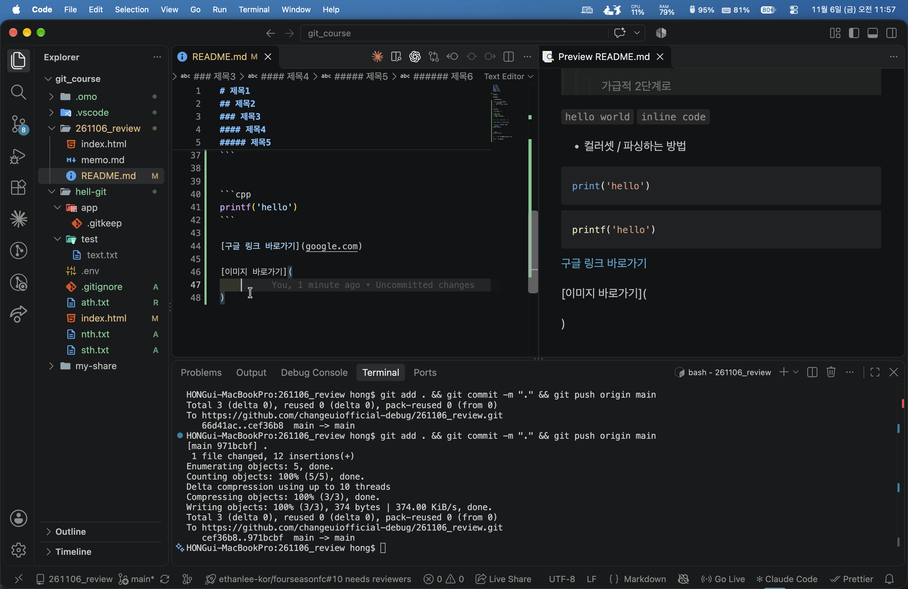

# 제목1
## 제목2
### 제목3
#### 제목4
##### 제목5
###### 제목6

---
**강조**

*기울임*

___강조기울임___

- -는 순서 없는 말머리
    - 들여쓰기
+ -대신 +플러스로 써보기

---

체크박스
- [ ] 할일
- [x] 완료한 일

> 인용 내용
>> 인용 내용은 
>>> 가급적 2단계로


<!-- 주석은 cmd 슬래쉬 -->

`hello world` `inline code`

- 컬러셋 / 파싱하는 방법
```python
print('hello')
```


```cpp
printf('hello')
```

[구글 링크 바로가기](google.com)




테이블
|제목1|제목2|제목3|
|-|-|-|
|내용1|내용2|내용3|

