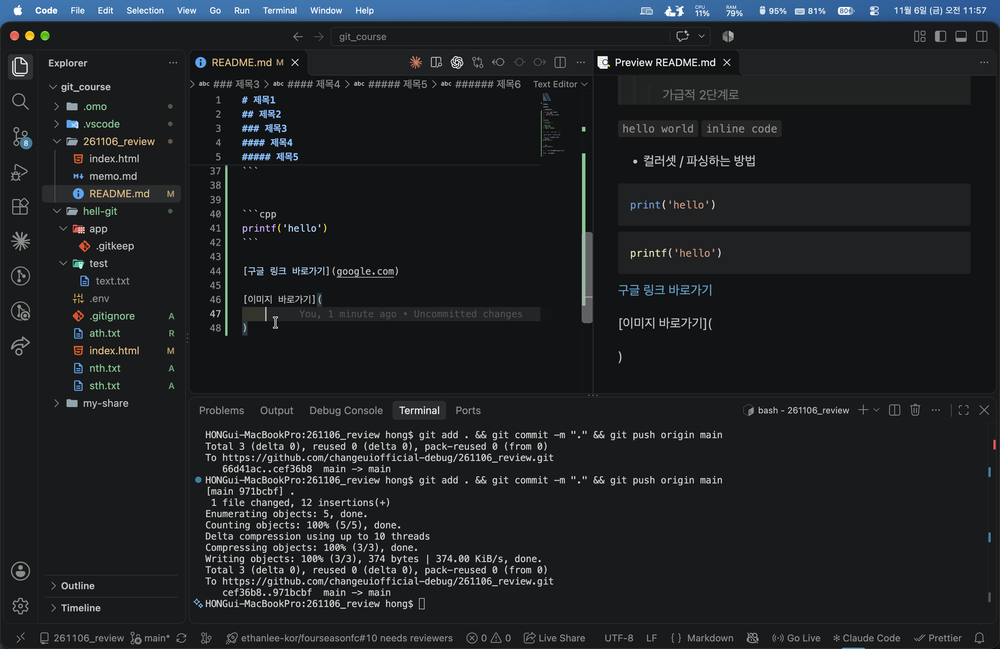
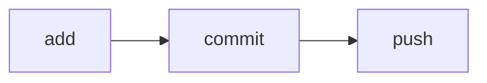

# 마크다운(Markdown) 문법 완전 정복

> 코딩 초보자도 따라 할 수 있고, 면접·실무에서도 꺼내 쓸 수 있도록 정리한 문서입니다.
> 기준 자료: 이 폴더의 `README.md` (실습 파일)

## 목차

1. [마크다운이란?](#1-마크다운이란)
2. [제목](#2-제목-heading)
3. [강조: 굵게, 기울임](#3-강조-굵게-기울임)
4. [목록](#4-목록-list)
5. [체크박스](#5-체크박스-task-list)
6. [인용문](#6-인용문-blockquote)
7. [주석](#7-주석)
8. [코드](#8-코드-인라인과-코드블록)
9. [링크](#9-링크)
10. [이미지](#10-이미지)
11. [표](#11-표-table)
12. [구분선](#12-구분선)
13. [줄바꿈과 문단](#13-줄바꿈과-문단)
14. [트러블슈팅 모음](#14-트러블슈팅-모음)
15. [응용 케이스](#15-응용-케이스)
16. [기술면접 대비 Q&A](#16-기술면접-대비-qa)
17. [한눈에 보는 치트시트](#17-한눈에-보는-치트시트)

---

## 1. 마크다운이란?

**한 줄 요약:** 특수기호(`#`, `*`, `-` 등)만으로 글의 모양(제목, 굵게, 목록 등)을 표현하는 글쓰기 방법입니다.

### 왜 쓰나요?

| 워드/한글 | 마크다운 |
|---|---|
| 마우스로 버튼을 눌러 서식 지정 | 키보드로 기호만 입력 |
| 파일이 프로그램에 종속됨 | 그냥 텍스트 파일(`.md`)이라 어디서든 열림 |
| 변경 이력 비교가 어려움 | Git으로 "무엇이 바뀌었는지" 정확히 비교 가능 |

### 어디에 쓰이나요?

- **GitHub**의 `README.md` (프로젝트 첫 화면)
- 개발 문서, 위키, 블로그(Velog, Tistory 등)
- 노션, 옵시디언 같은 노트 앱
- 이슈, PR(Pull Request) 설명, 커밋 문서
- AI 도구(Claude Code의 `CLAUDE.md` 등) 설정 파일

### 핵심 개념: "작성"과 "렌더링"

- **작성(원문):** 내가 `# 제목`이라고 타이핑한 상태
- **렌더링(미리보기):** 프로그램이 그걸 해석해서 큼직한 제목으로 보여 주는 상태

> VS Code에서 `Cmd+K` → `V`(Windows는 `Ctrl+K` → `V`)를 누르면 옆에 미리보기 창이 열립니다.

---

## 2. 제목 (Heading)

`#`의 개수가 많을수록 작은 제목입니다. **`#` 뒤에 반드시 공백 한 칸**을 넣으세요.

```markdown
# 제목1
## 제목2
### 제목3
#### 제목4
##### 제목5
###### 제목6
```

| 입력 | 의미 | 쓰임새 |
|---|---|---|
| `#` | 제목1 (h1) | 문서 전체 제목. **문서당 1개** 권장 |
| `##` | 제목2 (h2) | 큰 단락 |
| `###` | 제목3 (h3) | 작은 단락 |
| `####` ~ `######` | 제목4~6 | 거의 안 씀. 3단계까지만 써도 충분 |

### 실무 팁

- 제목을 건너뛰지 않습니다. (`#` 다음에 바로 `###` ❌)
- 제목은 **목차 역할**을 합니다. GitHub는 제목을 보고 자동으로 목차(우측 상단 아이콘)를 만들어 줍니다.
- 제목마다 자동으로 **앵커(링크 주소)** 가 생깁니다. `## 코드 블록`은 `#코드-블록`으로 연결할 수 있습니다. (공백은 `-`, 영문은 소문자)

---

## 3. 강조 (굵게, 기울임)

```markdown
**굵게**
*기울임*
***굵게+기울임***
___굵게+기울임___
~~취소선~~
```

**렌더링 결과**

**굵게** / *기울임* / ***굵게+기울임*** / ~~취소선~~

| 문법 | 개수 | 결과 |
|---|---|---|
| `*글자*` 또는 `_글자_` | 1개 | *기울임* |
| `**글자**` 또는 `__글자__` | 2개 | **굵게** |
| `***글자***` 또는 `___글자___` | 3개 | ***굵게+기울임*** |
| `~~글자~~` | 물결 2개 | ~~취소선~~ |

### 외우는 법

별(`*`) 또는 밑줄(`_`)이 **1개면 기울임, 2개면 굵게, 3개면 둘 다**입니다.

### 주의

- 기호와 글자 사이에 **공백을 넣지 마세요.** `** 굵게 **`는 굵게 적용이 안 됩니다.
- 한글은 원래 기울임체 글꼴이 약해서 기울임이 티가 덜 납니다. 한글 강조는 **굵게**를 주로 씁니다.

---

## 4. 목록 (List)

### 4-1. 순서 없는 목록

`-`, `*`, `+` 중 아무거나 쓸 수 있고, **뒤에 공백 한 칸**이 필요합니다.

```markdown
- 사과
- 바나나
    - 들여쓰기하면 하위 목록
        - 더 들여쓰면 하위의 하위
+ 플러스도 가능
* 별표도 가능
```

- 사과
- 바나나
    - 들여쓰기하면 하위 목록
        - 더 들여쓰면 하위의 하위

> 한 문서 안에서는 **한 가지 기호로 통일**하세요. (보통 `-`) 섞어 쓰면 읽기 어렵고, 일부 도구는 목록이 끊어진 것으로 인식합니다.

### 4-2. 순서 있는 목록

```markdown
1. 첫 번째
2. 두 번째
3. 세 번째
```

1. 첫 번째
2. 두 번째
3. 세 번째

**꿀팁:** 숫자를 전부 `1.`로 써도 자동으로 1, 2, 3으로 번호가 매겨집니다. 항목을 중간에 끼워 넣을 때 번호를 다시 안 고쳐도 되어 편합니다.

### 4-3. 들여쓰기 규칙

- 하위 목록은 **탭 1번 또는 공백 2~4칸**으로 들여씁니다.
- 순서 있는 목록 안에 하위 목록을 넣을 때는 **공백 3칸 이상**이 안전합니다.

```markdown
1. 설치하기
   - Mac은 brew 사용
   - Windows는 설치 파일 실행
2. 실행하기
```

---

## 5. 체크박스 (Task List)

```markdown
- [ ] 할 일
- [x] 완료한 일
```

- [ ] 할 일
- [x] 완료한 일

### 규칙

- `- [ ]` 에서 **대괄호 안에 공백 1칸**이 있어야 빈 체크박스입니다. (`[]`처럼 붙이면 안 됨)
- 완료는 `[x]` (소문자 x)입니다.

### 어디에 쓰나요?

- GitHub 이슈/PR에서는 **미리보기 화면에서 직접 클릭**해서 체크할 수 있습니다.
- PR 템플릿의 "배포 전 체크리스트"에 자주 씁니다.

---

## 6. 인용문 (Blockquote)

`>` 를 줄 맨 앞에 붙입니다.

```markdown
> 인용 내용
>> 인용 안의 인용
>>> 3단계 (가독성이 떨어지니 가급적 2단계까지만)
```

> 인용 내용
>> 인용 안의 인용
>>> 3단계

### 실무 활용

- 참고/주의사항 표시: `> **주의:** 이 명령은 되돌릴 수 없습니다.`
- 다른 사람의 말, 에러 메시지, 문서 원문 인용
- GitHub에서는 특수 알림 문법도 지원합니다. (뒤의 [응용 케이스](#15-응용-케이스) 참고)

---

## 7. 주석

화면에는 안 보이고 **원문에서만 보이는 메모**입니다.

```markdown
<!-- 이 줄은 미리보기에 나타나지 않습니다 -->
```

<!-- 이 줄은 미리보기에 나타나지 않습니다 -->

### 단축키

- VS Code에서 줄을 선택하고 `Cmd+/` (Windows는 `Ctrl+/`) → 자동으로 `<!-- -->` 로 감싸 줍니다.

### 주의

- 주석은 **화면에서만 안 보일 뿐, 원문에는 그대로 남습니다.** GitHub에 올리면 누구나 소스를 보면 읽을 수 있으므로 **비밀번호·개인정보를 주석에 적지 마세요.**

---

## 8. 코드 (인라인과 코드블록)

### 8-1. 인라인 코드 (문장 속 코드)

백틱(`` ` ``) 하나로 감쌉니다. 키보드에서 **숫자 1 왼쪽 키**(한글 모드에서도 같은 키)입니다.

```markdown
터미널에 `git status`를 입력하세요.
```

터미널에 `git status`를 입력하세요.

### 8-2. 코드블록 (여러 줄 코드)

백틱 3개로 위아래를 감싸고, **여는 줄 뒤에 언어 이름**을 적으면 색이 입혀집니다(문법 강조, syntax highlighting).

````markdown
```python
print('hello')
```

```cpp
printf("hello");
```
````

```python
print('hello')
```

```cpp
printf("hello");
```

### 자주 쓰는 언어 이름

| 쓰는 이름 | 대상 |
|---|---|
| `python` | 파이썬 |
| `javascript` / `js` | 자바스크립트 |
| `html`, `css` | 웹 |
| `bash` / `sh` / `shell` | 터미널 명령어 |
| `json`, `yaml` | 설정 파일 |
| `diff` | 변경 사항 (+ 초록, - 빨강) |
| `markdown` / `md` | 마크다운 자체 |
| (비워둠) | 색 없이 일반 텍스트 |

### `diff`로 변경점 보여 주기

````markdown
```diff
- print('hello')
+ print('hello world')
```
````

```diff
- print('hello')
+ print('hello world')
```

### 코드 안에 백틱이 들어가야 할 때

바깥 울타리를 **한 개 더 많은 백틱**으로 감쌉니다. (이 문서에서 마크다운 예시를 보여 줄 때 `` ```` ``(4개)를 쓴 이유입니다.)

---

## 9. 링크

```markdown
[보여줄 글자](주소)
[구글 바로가기](https://google.com)
[제목 있는 링크](https://google.com "마우스를 올리면 나오는 설명")
<https://google.com>
```

[구글 바로가기](https://google.com)

### 링크 종류

| 종류 | 예시 | 설명 |
|---|---|---|
| 외부 링크 | `[구글](https://google.com)` | `https://`까지 반드시 적기 |
| 같은 폴더의 파일 | `[메모](memo.md)` | 상대 경로 |
| 하위 폴더의 파일 | `[이미지](docs/guide.md)` | 폴더/파일 |
| 상위 폴더의 파일 | `[상위](../README.md)` | `..` 은 한 단계 위 |
| 문서 내 이동 | `[목차로](#목차)` | 제목 앵커 |
| 자동 링크 | `<https://example.com>` | 주소 자체를 링크로 |

### ⚠️ 흔한 실수: `https://` 빠뜨림

`README.md`에 `[구글 링크 바로가기](google.com)` 이라고 적으면 **구글로 가지 않습니다.** 마크다운은 `google.com`을 "이 폴더에 있는 `google.com`이라는 파일"로 해석합니다. 반드시 `https://google.com`으로 적으세요. (자세한 건 [트러블슈팅](#14-트러블슈팅-모음))

---

## 10. 이미지

링크 문법 **앞에 `!`** 만 붙이면 이미지입니다.

```markdown



```

### 구성

```

│   │           │
│   │           └─ 파일 위치 (상대 경로 or URL)
│   └─ 이미지가 안 뜰 때 대신 보이는 글, 시각장애인용 스크린리더가 읽는 글
└─ 이거 하나가 링크와의 차이
```

### 실무 팁

- **대체 텍스트(alt)는 꼭 의미 있게** 적습니다. `alt text` 그대로 두면 접근성도, 검색도 손해입니다.
- 이미지는 `images/` 같은 **전용 폴더**에 모읍니다. (이 폴더의 `image.png`는 약 800KB — 더 커지면 저장소가 무거워지니 압축해서 올리세요.)
- 파일명은 **영문 소문자와 하이픈**으로 짓습니다. (`포켓몬 카드.png` ❌ → `pokemon-card.png` ✅)
- **크기 조절**은 순수 마크다운으로는 안 되고 HTML을 씁니다.

```html

```

- 이미지에 링크를 걸려면 두 문법을 겹칩니다.

```markdown
[](https://example.com)
```

---

## 11. 표 (Table)

```markdown
|제목1|제목2|제목3|
|-|-|-|
|내용1|내용2|내용3|
|내용4|내용5|내용6|
```

|제목1|제목2|제목3|
|-|-|-|
|내용1|내용2|내용3|
|내용4|내용5|내용6|

### 구조

1. 첫 줄: **헤더**(열 제목)
2. 둘째 줄: **구분선** `|-|-|-|` — 이 줄이 없으면 표가 안 만들어집니다.
3. 셋째 줄부터: **내용**

### 정렬하기

구분선에 `:`를 붙입니다.

```markdown
| 왼쪽 정렬 | 가운데 정렬 | 오른쪽 정렬 |
|:---|:---:|---:|
| 가 | 나 | 다 |
```

| 왼쪽 정렬 | 가운데 정렬 | 오른쪽 정렬 |
|:---|:---:|---:|
| 가 | 나 | 다 |

### 표 안에서 자주 겪는 문제

| 하고 싶은 것 | 방법 |
|---|---|
| 칸 안에 `\|` 문자 쓰기 | `\|` 로 이스케이프 |
| 칸 안에서 줄바꿈 | `<br>` 사용 |
| 칸 안에 코드 쓰기 | `` `code` `` 가능 (단, 코드 안 `\|`도 이스케이프 필요) |
| 칸 합치기 | 마크다운 불가 → HTML `<table>` 사용 |

### 꿀팁

- 표 정렬(칸 맞추기)은 손으로 하지 마세요. VS Code 확장 **Markdown All in One**이 `Shift+Alt+F`로 자동으로 맞춰 줍니다.
- 열이 5개를 넘어가면 가독성이 떨어집니다. 목록으로 바꾸는 것도 고려하세요.

---

## 12. 구분선

```markdown
---
***
___
```

---

셋 중 아무거나 가능합니다. 보통 `---`를 씁니다.

### ⚠️ 함정: 글자 바로 아래의 `---`

```markdown
제목처럼 보이게 하고 싶은 글
---
```

글 **바로 아래 줄**에 `---`를 쓰면 구분선이 아니라 **제목2(h2)** 가 됩니다. 구분선 앞뒤로는 **빈 줄을 하나씩** 두세요.

---

## 13. 줄바꿈과 문단

마크다운에서 가장 헷갈리는 부분입니다.

```markdown
첫째 줄
둘째 줄
```

위처럼 그냥 엔터 한 번만 치면 **미리보기에서는 한 줄로 이어 붙습니다.**

### 줄바꿈 3가지 방법

| 방법 | 입력 | 설명 |
|---|---|---|
| **빈 줄** | 엔터 2번 | 새 문단 (가장 권장) |
| **공백 2칸 + 엔터** | `첫째 줄··↵` | 같은 문단 안에서 줄바꿈 (눈에 안 보여 실수하기 쉬움) |
| **`<br>`** | `첫째 줄<br>둘째 줄` | 확실하게 줄바꿈. 표 안에서도 가능 |

> 에디터가 줄 끝 공백을 자동으로 지워 버리는 경우가 있어서, 공백 2칸 방식은 불안정합니다. 확실히 하려면 **빈 줄**이나 `<br>`을 쓰세요.

### 특수문자 이스케이프

기호 자체를 글자로 보여 주고 싶을 때는 앞에 `\`를 붙입니다.

```markdown
\* 별표가 그대로 나옵니다 \*
\# 샵이 그대로 나옵니다
1\. 숫자 목록으로 변하지 않습니다
```

\* 별표가 그대로 나옵니다 \*

---

## 14. 트러블슈팅 모음

문제가 생겼을 때 **증상 → 원인 → 해결** 순서로 찾아보세요.

### 🔧 1. 제목(`#`)이 제목으로 안 보여요

| | |
|---|---|
| 증상 | `#제목` 이 그냥 글자로 나옴 |
| 원인 | `#` 뒤에 공백이 없음 |
| 해결 | `# 제목` 처럼 **공백 한 칸** 추가 |

### 🔧 2. 목록이 제대로 안 만들어져요

| | |
|---|---|
| 증상 | `-사과` 가 그냥 글자로 나옴 |
| 원인 | `-` 뒤에 공백 없음 |
| 해결 | `- 사과` |

또 하나의 원인: **목록 바로 위 줄에 글자가 붙어 있는 경우.** 일부 렌더러는 목록 앞에 빈 줄이 없으면 목록으로 인식하지 못합니다. 목록 위에 **빈 줄**을 넣으세요.

### 🔧 3. 링크를 눌렀는데 `404 Not Found`가 떠요

| | |
|---|---|
| 증상 | `[구글](google.com)` 클릭 시 내 사이트 주소 뒤에 `/google.com`이 붙어서 404 |
| 원인 | `https://`가 없어서 **상대 경로(내 폴더의 파일)** 로 해석됨 |
| 해결 | `[구글](https://google.com)` |

### 🔧 4. 이미지가 깨져서 나와요 (엑박)

체크리스트를 위에서부터 확인하세요.

1. **경로**가 맞나요? `image.png`는 `.md` 파일과 같은 폴더에 있어야 합니다.
2. **파일명 대소문자**가 정확한가요? Mac은 `Image.png`와 `image.png`를 같은 걸로 보지만, **GitHub(리눅스 서버)는 다른 파일로 봅니다.** → 로컬에서는 되는데 GitHub에서만 깨지는 대표 원인입니다.
3. **파일명에 공백·한글**이 있나요? 있다면 영문과 하이픈으로 바꾸세요. 꼭 써야 하면 공백을 `%20`으로 적습니다.
4. 이미지를 **git에 add/commit/push** 했나요? 로컬에만 있고 올리지 않으면 GitHub에서는 안 보입니다.
5. 절대 경로(`/Users/hong/...`)를 쓰지 않았나요? **상대 경로만** 쓰세요. 내 컴퓨터에만 있는 경로라 다른 사람(과 다른 기기)에서는 깨집니다.

### 🔧 5. 코드블록이 끝나지 않고 문서 전체가 코드처럼 나와요

| | |
|---|---|
| 증상 | 코드블록 이후의 모든 내용이 회색 박스 안에 들어감 |
| 원인 | 닫는 ` ``` ` 를 빼먹음 |
| 해결 | 열고 닫는 ` ``` ` 개수 확인. 코드 안에 ` ``` `가 있다면 바깥을 ` ```` `(4개)로 |

### 🔧 6. 표가 표로 안 나와요

점검 순서:

1. 표 **위에 빈 줄**이 있는가
2. 둘째 줄 구분선 `|-|-|-|` 이 있는가
3. 헤더 칸 개수와 구분선 칸 개수가 **같은가**
4. 칸 안에 `|` 문자가 있다면 `\|` 로 바꿨는가

### 🔧 7. 엔터를 쳤는데 줄이 안 바뀌어요

[13. 줄바꿈](#13-줄바꿈과-문단)을 보세요. **빈 줄 한 줄**을 추가하거나 줄 끝에 `<br>`을 붙입니다.

### 🔧 8. 들여쓴 내용이 갑자기 회색 코드 박스로 나와요

| | |
|---|---|
| 증상 | 일반 문장인데 회색 박스로 보임 |
| 원인 | 빈 줄 뒤에 **공백 4칸 이상(또는 탭)** 으로 시작하면 마크다운이 "코드"로 해석 |
| 해결 | 목록 하위 항목이 아니라면 들여쓰지 않기 |

### 🔧 9. 굵게(`**`)가 안 먹어요

- `** 굵게 **` 처럼 기호 **안쪽에 공백**이 있지 않은지 확인합니다.
- 한글 조사와 붙여 쓸 때(`**굵게**를`) 일부 렌더러에서 깨지는 경우가 있습니다. 그럴 땐 `**굵게** 를`처럼 띄우거나 `<b>굵게</b>`를 씁니다.

### 🔧 10. VS Code 미리보기가 안 열려요

1. 파일 확장자가 `.md`인지 확인합니다. (`.txt`면 안 됨)
2. 하단 상태 표시줄 우측의 언어 모드가 **Markdown**인지 확인합니다. 아니면 클릭해서 변경합니다.
3. `Cmd+Shift+P` → `Markdown: Open Preview to the Side` 실행.

### 🔧 11. 로컬 미리보기와 GitHub 화면이 달라요

- 마크다운 규격은 하나가 아닙니다. **GitHub는 GFM(GitHub Flavored Markdown)** 이라는 확장판을 씁니다. 표, 체크박스, 취소선은 GFM 기능입니다.
- 각 도구(VS Code, 노션, 벨로그)마다 지원 범위가 조금씩 다릅니다. **최종 확인은 실제로 보여질 곳**에서 합니다.

### 🔧 12. `git push` 했는데 README가 GitHub에 안 바뀌어요

1. `git status`로 수정 파일이 **add/commit** 됐는지 확인
2. `git log --oneline -3`으로 커밋이 만들어졌는지 확인
3. 푸시 명령에서 `&&`가 빠지지 않았는지 확인

```bash
git add . && git commit -m "README 수정" && git push origin main
```

---

## 15. 응용 케이스

### 15-1. 좋은 README 템플릿

프로젝트 운영·포트폴리오에서 가장 많이 쓰는 형태입니다.

````markdown
# 프로젝트 이름

한 줄 소개: 이 프로젝트가 무엇을 하는지


## ✨ 주요 기능
- 기능 1
- 기능 2

## 🛠 기술 스택
| 구분 | 사용 기술 |
|---|---|
| 프론트엔드 | HTML, CSS, JavaScript |
| 배포 | GitHub Pages |

## 🚀 실행 방법
```bash
git clone https://github.com/아이디/저장소.git
cd 저장소
open index.html
```

## 📁 폴더 구조
```text
.
├── index.html
├── README.md
└── images/
```

## 📝 변경 이력
- 2026-11-06: 최초 작성

## 📄 라이선스
MIT
````

### 15-2. 접었다 펴는 영역 (`<details>`)

긴 내용(로그, FAQ)을 숨겨 둘 때 씁니다.

```markdown
<details>
<summary>클릭해서 펼치기</summary>

숨겨진 내용입니다.

```python
print('secret')
```

</details>
```

<details>
<summary>클릭해서 펼치기</summary>

숨겨진 내용입니다.

</details>

> `<summary>` 아래와 `</details>` 위에 **빈 줄**이 있어야 안쪽 마크다운이 정상 렌더링됩니다.

### 15-3. GitHub 알림 박스

```markdown
> [!NOTE]
> 참고 사항입니다.

> [!TIP]
> 유용한 팁입니다.

> [!IMPORTANT]
> 꼭 알아야 할 내용입니다.

> [!WARNING]
> 주의가 필요합니다.

> [!CAUTION]
> 위험할 수 있는 작업입니다.
```

> GitHub에서만 색상 박스로 보입니다. VS Code 기본 미리보기에서는 일반 인용문으로 보일 수 있습니다.

### 15-4. 배지(Badge)

README 상단의 작은 상태 표시입니다. 이미지 문법의 응용입니다.

```markdown


```

### 15-5. 각주

```markdown
마크다운은 2004년에 만들어졌습니다.[^1]

[^1]: 존 그루버(John Gruber)가 제안했습니다.
```

### 15-6. 수식 (GitHub, Notion 등 지원)

```markdown
인라인: $E = mc^2$

블록:
$$
\sum_{i=1}^{n} i = \frac{n(n+1)}{2}
$$
```

### 15-7. 다이어그램 (Mermaid)

GitHub는 코드블록에 `mermaid`를 쓰면 그림으로 바꿔 줍니다.

````markdown

````


### 15-8. 이슈/PR 템플릿 (체크박스 활용)

```markdown
## 변경 내용
-

## 체크리스트
- [ ] 로컬에서 동작 확인
- [ ] 이미지 경로 확인
- [ ] 오타 확인
```

### 15-9. 학습 노트로 쓰기

```markdown
# 2026-11-06 Git 수업

## 오늘 배운 것
- `git add` : 변경 파일을 올릴 준비
- `git commit` : 기록으로 저장
- `git push` : 원격 저장소에 업로드

## 막혔던 점
- `&&`를 빠뜨려서 `pathspec` 에러 발생 → 명령어 사이에 `&&` 필요

## 내일 할 일
- [ ] 브랜치 개념 복습
```

### 15-10. 마크다운을 다른 형식으로 변환

| 목적 | 방법 |
|---|---|
| PDF로 저장 | VS Code 확장 *Markdown PDF* 또는 `pandoc 파일.md -o 파일.pdf` |
| HTML로 변환 | `pandoc 파일.md -o 파일.html` |
| 블로그 업로드 | 벨로그·티스토리에 원문 그대로 붙여넣기 (대부분 지원) |
| 노션으로 | 노션 페이지에 붙여넣으면 자동 변환 |

---

## 16. 기술면접 대비 Q&A

### Q1. 마크다운이 무엇인가요?

> 텍스트 기반의 경량 마크업 언어입니다. 특수기호로 서식을 표현하고, HTML로 변환해서 보여 줍니다. 일반 텍스트 파일이라 **버전 관리(Git)에 적합**하고, 특정 프로그램에 종속되지 않습니다.

### Q2. 마크다운과 HTML의 차이는?

> HTML은 태그(`<h1>`)로 구조를 정의하는 웹 표준 언어이고, 마크다운은 그보다 **훨씬 간단한 문법**으로 쓰고 결국 HTML로 변환됩니다. 마크다운 안에 HTML을 섞어 쓸 수도 있습니다. (예: 이미지 크기 조절 ``)

### Q3. 왜 개발 문서에 마크다운을 쓰나요?

> 1. 코드와 같은 저장소에서 **함께 버전 관리**할 수 있다
> 2. `git diff`로 **문서 변경점을 줄 단위로 비교**할 수 있다
> 3. 배우기 쉬워 **팀원 누구나 문서를 수정**할 수 있다
> 4. GitHub, GitLab 등이 **자동으로 렌더링**해 준다

### Q4. README.md는 왜 중요한가요?

> 저장소를 열면 **가장 먼저 보이는 문서**입니다. 프로젝트 소개, 설치·실행 방법, 사용법을 담아서 **처음 보는 사람의 진입 장벽**을 낮춥니다. 면접관·동료가 포트폴리오를 볼 때 첫 인상이 됩니다.

### Q5. GFM이란?

> GitHub Flavored Markdown. 표준 마크다운(CommonMark)에 **표, 체크박스, 취소선, 자동 링크, 코드블록 언어 지정** 등을 더한 GitHub의 확장 규격입니다. 그래서 도구마다 렌더링 결과가 조금 다를 수 있습니다.

### Q6. 상대 경로와 절대 경로의 차이를 이미지 삽입과 연결해 설명해 보세요.

> 상대 경로(`images/a.png`)는 **현재 문서 기준 위치**라 저장소를 어디로 옮겨도 동작합니다. 절대 경로(`/Users/me/a.png`)는 **내 컴퓨터에서만** 유효해서 다른 사람의 환경이나 GitHub에서 깨집니다. 그래서 문서에서는 상대 경로를 씁니다.

### Q7. 로컬에서는 이미지가 보이는데 GitHub에서는 깨져요. 원인은?

> 1. 이미지를 **커밋·푸시하지 않음**
> 2. **파일명 대소문자 불일치** (macOS는 구분 안 함, GitHub 서버는 구분)
> 3. 절대 경로 사용
> 4. 파일명의 공백·한글 인코딩 문제

### Q8. 마크다운에서 줄바꿈은 어떻게 하나요?

> 엔터 한 번은 줄바꿈이 되지 않습니다. **빈 줄**로 문단을 나누거나, 줄 끝에 **공백 2칸** 또는 `<br>`을 씁니다. 에디터가 공백을 지우는 경우가 있어 `<br>`이 가장 확실합니다.

### Q9. 민감한 정보가 README에 들어가면 어떻게 되나요?

> 주석(`<!-- -->`)으로 가려도 **원문에는 남아** 있고, 한 번 푸시하면 **Git 기록(히스토리)에 영구히** 남습니다. API 키·비밀번호는 절대 문서나 코드에 쓰지 않고, 환경변수와 `.gitignore`로 관리합니다. 이미 올렸다면 키를 폐기(재발급)하는 게 먼저입니다.

### Q10. 문서 품질을 팀에서 어떻게 유지하나요?

> - PR 템플릿과 체크리스트를 활용
> - 린터 사용 (`markdownlint`)로 문법 일관성 검사
> - 코드 변경 시 **관련 문서도 같은 PR에서 함께 수정**하는 규칙
> - 문서 폴더 구조와 제목 규칙을 합의

---

## 17. 한눈에 보는 치트시트

| 하고 싶은 것 | 입력 | 결과 |
|---|---|---|
| 큰 제목 | `# 제목` | 제목1 |
| 굵게 | `**글**` | **글** |
| 기울임 | `*글*` | *글* |
| 취소선 | `~~글~~` | ~~글~~ |
| 목록 | `- 항목` | • 항목 |
| 번호 목록 | `1. 항목` | 1. 항목 |
| 체크박스 | `- [ ] 할 일` | ☐ 할 일 |
| 인용 | `> 글` | 인용 블록 |
| 인라인 코드 | `` `code` `` | `code` |
| 코드블록 | ` ```python ` ... ` ``` ` | 색이 입혀진 코드 |
| 링크 | `[글](https://주소)` | 링크 |
| 이미지 | `` | 이미지 |
| 표 | `\|a\|b\|` + `\|-\|-\|` | 표 |
| 구분선 | `---` | 가로줄 |
| 줄바꿈 | 빈 줄 / `<br>` | 줄바꿈 |
| 주석 | `<!-- 글 -->` | 숨김 |
| 이스케이프 | `\*` | * |

### 내 실수 노트 (이 폴더 실습에서 나온 것)

- [x] 링크에 `https://`를 빠뜨리면 외부 사이트로 안 간다 → `README.md`의 `(google.com)`
- [x] `git commit -m "..." git push` 처럼 `&&` 없이 이어 쓰면 `pathspec` 에러가 난다
- [x] 커밋 메시지를 `"."` 로 쓰면 나중에 기록을 봐도 무슨 변경인지 모른다
- [ ] `image.png` 같은 이미지 이름을 의미 있는 영문명으로 바꿔 보기

---

*마지막 수정: 2026-11-06*
